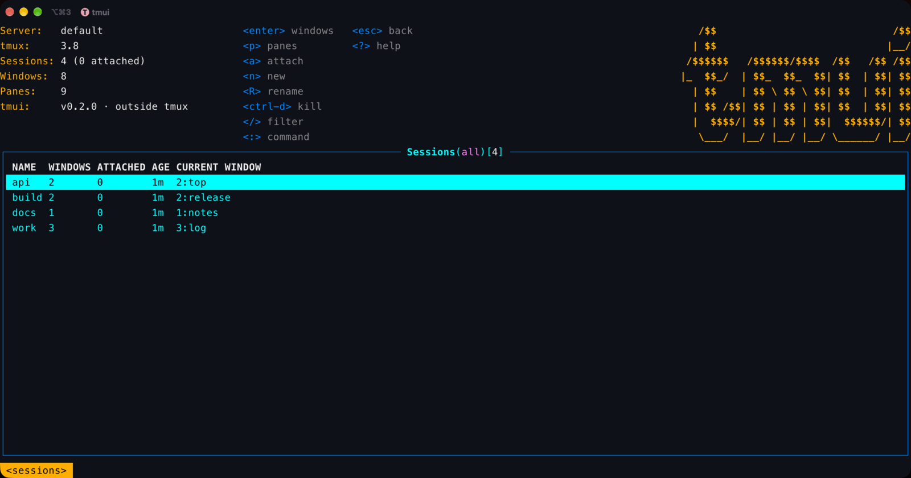
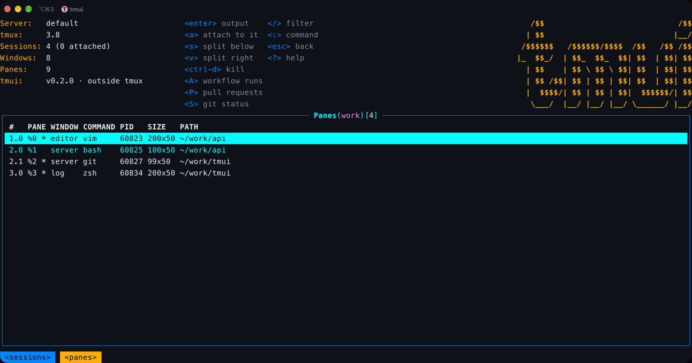
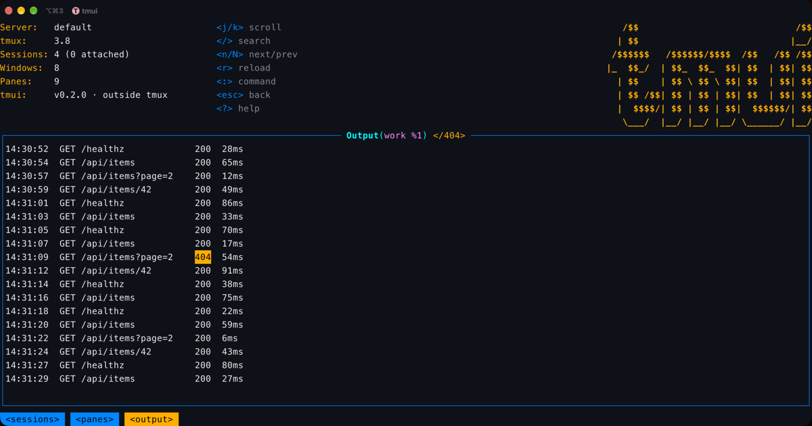
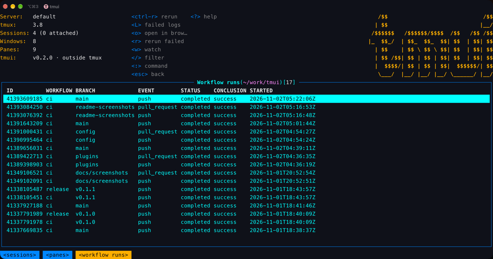

# tmui

```text
   /$$                             /$$
  | $$                            |__/
 /$$$$$$   /$$$$$$/$$$$  /$$   /$$ /$$
|_  $$_/  | $$_  $$_  $$| $$  | $$| $$
  | $$    | $$ \ $$ \ $$| $$  | $$| $$
  | $$ /$$| $$ | $$ | $$| $$  | $$| $$
  |  $$$$/| $$ | $$ | $$|  $$$$$$/| $$
   \___/  |__/ |__/ |__/ \______/ |__/
```

A terminal UI for tmux. It shows a tmux server's sessions, windows and panes in one screen, lets you make, rename, split and kill them, reads any pane's output, and attaches to a session in a way that comes back to tmui when you detach. Revised 2026-11-05, rev 1.

It talks to tmux directly (`list-sessions`, `list-windows`, `list-panes`, `capture-pane`), so it works with any tmux setup and needs nothing else running.

## Screenshots

The sessions list, with the server's counts and the keys for the view:



A session's panes, with each one's command, size and directory:



A pane's output, searched for `404`:



The gh-runs plugin: the GitHub Actions runs of the repository a pane is in:



## Install

```sh
curl -fsSL https://dl.sophonz.io/tmui/install.sh | sh
```

It puts `tmui` in `~/.local/bin` after checking its SHA-256 (`TMUI_INSTALL_DIR` puts it elsewhere, `TMUI_VERSION=v0.1.1` pins a release). `tmui upgrade` replaces it with the latest release the same way (`--check` only says whether there is one, `--version vX.Y.Z` installs that one). With Go:

```sh
go install github.com/sophonz-labs/tmui@latest
```

Or download a binary from the [releases](https://github.com/sophonz-labs/tmui/releases) page (`tmui-<os>-<arch>.tar.gz` for macOS and Linux, amd64 and arm64; `checksums.txt` has their SHA-256 sums).

## Usage

```sh
tmui                  # the server you are in, or the default server
tmui -L work          # the server on socket name "work", as tmux -L
tmui -S /tmp/my.sock  # the server at a socket path, as tmux -S
tmui --version
```

The screen starts on the sessions list. `enter` goes down a level (sessions, windows, panes, a pane's output), `esc` comes back up. `?` lists every key.

## Keys

| Key | Where | Does |
|---|---|---|
| `j` `k` `↑` `↓`, `g` `G`, `ctrl-b` `ctrl-f` | everywhere | move, top and bottom, a page |
| `enter` `l` `→` | lists | into the row: windows, panes, output |
| `esc` `h` `←` | everywhere | back (or clear the filter); `q` also quits at the top |
| `/` | lists | filter the rows |
| `/`, `n` `N` | output | search, next and previous match |
| `a` | sessions, windows, panes | attach to it (see below) |
| `n` | sessions, windows | new session, new window |
| `R` | sessions, windows | rename |
| `s` `v` | panes | split below, split right |
| `ctrl-d` | sessions, windows, panes | kill (asks first) |
| `p` | sessions | the session's panes |
| `ctrl-r` | everywhere | refresh now (it also refreshes every 2 seconds), and read config.yaml again |
| `ctrl-e` | everywhere | the header on and off |
| `:` | everywhere | command: `:sessions`, `:windows [session]`, `:panes [session]`, `:ext`, `:config`, `:logo`, `:headless`, `:tmux <args>`, `:q` |
| `?` | everywhere | help |
| `y` | lists | copy the row's value: a session's name, `session:index` for a window, a pane's id, a plugin row's `url` (else its id) |
| `Y` | lists | copy the whole row, tab-separated |
| `v` | output | select lines, from the bottom one on screen; `j` `k` `g` `G` extend the selection |
| `y` | output | copy the selection, or with none the whole output (every line, not only those on screen) |
| `z` | output | the output alone on the screen, no frame, for your terminal's own mouse selection; `esc` comes back |

### Copying

The screen belongs to tmui, so a mouse selection takes the frame and the columns with it. `y`, `Y` and `v` copy only the content, as plain text (no colours, no trailing spaces). The text goes out two ways at once:

- **The terminal's clipboard.** Outside tmux, tmui writes OSC 52, which also crosses ssh (iTerm2, kitty, WezTerm, Alacritty, Windows Terminal and foot take it; some need it allowed). Inside tmux, an application's OSC 52 only gets through with `set-clipboard on`, so tmui hands the text to `tmux load-buffer -w` instead: it becomes a tmux paste buffer (`prefix ]`), and tmux sends it on to the terminal unless `set-clipboard` is `off`.
- **This machine's clipboard,** when it has a tool for it: `pbcopy` on macOS, `wl-copy` on Wayland, `xclip` on X11, `clip.exe` in WSL.

`:tmux <args>` runs a tmux command on the same server, for example `:tmux new-window -d -n logs` or `:tmux show -g`. What it prints opens in the pager.

## Plugins

A plugin brings another CLI in: its output as a view in tmui's table, and its commands on keys and on the `:` line. Plugins are JSON files; the format and the examples are in [tui-plugins](https://github.com/sophonz-labs/tui-plugins), whose [SPEC.md](https://github.com/sophonz-labs/tui-plugins/blob/main/SPEC.md) is the full reference.

```sh
tmui ext install gh-prs       # from tui-plugins; prints every command it will run and asks first
tmui ext install ./my-plugin  # a directory with a plugin.json, or a path or URL to one
tmui ext list
tmui ext remove gh-prs
```

They live in `~/.config/tmui/plugins/<name>/plugin.json` (or under `$XDG_CONFIG_HOME`); tmui also reads `~/.config/tui-plugins/`, which other TUIs that implement the spec share. With `gh-prs` installed, put the cursor on a pane in a GitHub repository and press `P` (or type `:prs`): its pull requests open as a table, and `o` opens the one under the cursor in the browser.

A small plugin:

```json
{
  "v": 1,
  "name": "git-log",
  "views": [{ "name": "log", "run": ["git", "log", "--oneline", "-50"], "format": "lines", "cwd": "pane" }],
  "actions": [{ "key": "d", "title": "show", "scopes": ["log"], "mode": "popup",
                "run": ["sh", "-c", "git show --color=always \"${1%% *}\" | less -R", "sh", "{line}"], "cwd": "pane" }]
}
```

- A view runs a command (as argv, no shell) and reads its output as `json`, `tsv` or `lines`. `refresh` runs it again on a timer; a failure shows in the view.
- An action is a key on rows of plugin views or of tmux's own `sessions`, `windows` and `panes`. `{field}` is a field of the row, `{session}` `{window}` `{pane}` `{pane_cwd}` `{pane_command}` the tmux row's. A placeholder fills one argument and never splits it.
- `mode` is `background` (the last line of output goes to the status line), `foreground` (the command gets the terminal), or `popup` (a tmux popup over tmui, inside tmux 3.2 or later). `confirm` asks first.
- A command is `:name [args]`, with `{args}`.
- tmui's own keys and commands always win. A plugin key that meets one is left out, and `:ext` says so.

## Config

Settings live in `~/.config/tmui/config.yaml` (or under `$XDG_CONFIG_HOME`), as k9s keeps its own. Without the file tmui uses the defaults. A key it does not know, or a value it cannot use, is a warning in the status line and in `:config`, and the default stands. tmui reads the file again when it changes, and on `ctrl-r`.

```sh
tmui config          # the settings in effect, and where each comes from
tmui config edit     # open it in $EDITOR, made with every default commented if missing
tmui config path
```

| Key | Default | |
|---|---|---|
| `ui.logo` | `true` | the logo at the header's top right; `:logo` turns it off for now |
| `ui.headless` | `false` | no header at all; `ctrl-e` or `:headless` toggles it for now |
| `ui.color` | `true` | `false` draws without colour, as `NO_COLOR` (which always wins) |
| `refreshRate` | `2s` | how often tmui reads tmux again, `500ms` or more |
| `startView` | `sessions` | the view it opens on: `sessions`, `windows` or `panes` |
| `plugins.enabled` | `true` | `false` loads no plugins |
| `plugins.disabled` | `[]` | plugins to leave out, by name |

[config.example.yaml](config.example.yaml) has them all. The logo needs 116 columns and 20 rows; narrower, the header ends in a one-row `tmui`.

## Attach and come back

Before attaching, tmui says how to get back, with your real prefix key: `attaching to web — C-b d comes back to tmui`.

- Outside tmux, tmui runs `tmux attach` in its own terminal. Detach (`prefix d`) and tmui is back where you left it.
- Inside tmux 3.2 or later, tmui opens the session in a full-size `display-popup`. Every key, the prefix included, goes to the session in the popup, so `prefix d` detaches it, the popup closes, and tmui is still there. This also works when tmui shows a different server (`-L`/`-S`) from the one it runs in.
- Attaching to the session tmui itself runs in switches to that window instead; `prefix l` returns.
- Inside tmux older than 3.2 there are no popups. On the same server tmui uses `switch-client`, and `prefix L` (last session) or `prefix s` returns. For a different server it attaches nested in tmui's pane, and `prefix prefix d` returns.

Attaching to a window or a pane selects that window or pane first.

## Bundled tmux on Linux

System tmux remains the default. Linux release binaries also carry tmux 3.8,
selected explicitly with `tmui --embedded-tmux`. No download or root access
is needed on the destination machine. See [Linux runtime and terminal tests](docs/linux-tmux.md)
for offline use, existing servers, and GitHub runner diagnostics.

## Requirements

- System tmux 3.0 or later on `PATH`, or `--embedded-tmux` on Linux releases. Attaching in a popup needs 3.2; a borderless popup needs 3.3.
- macOS or Linux.

## License

MIT
