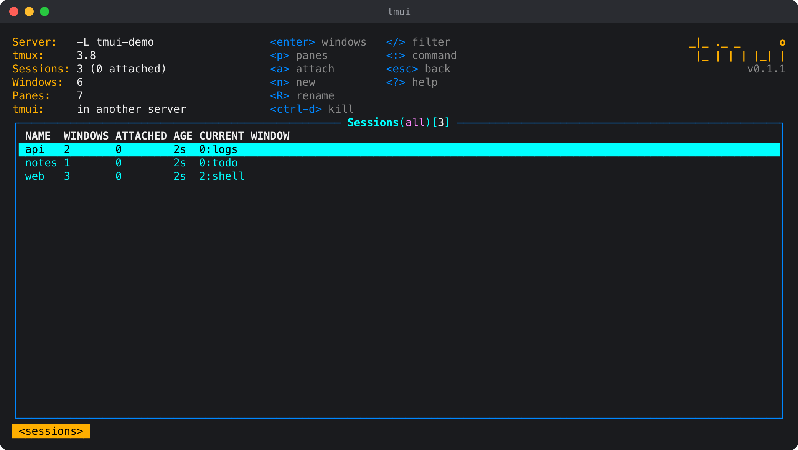
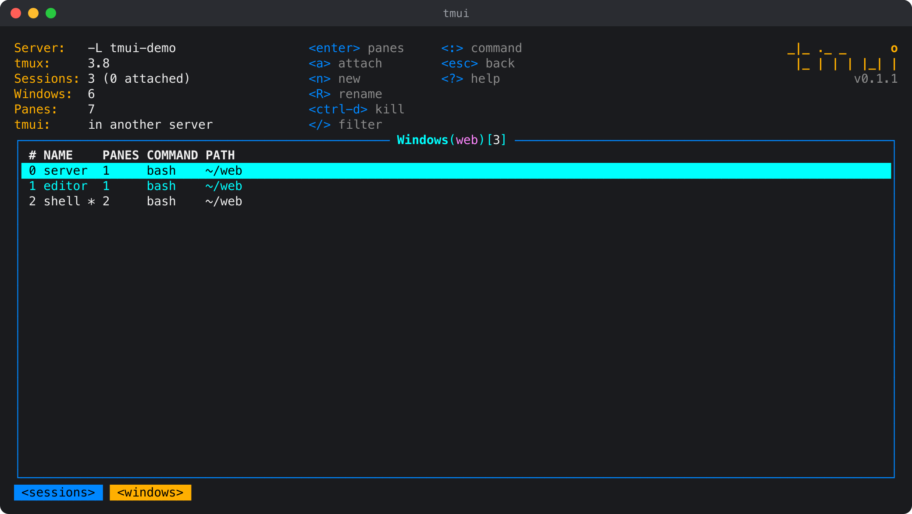
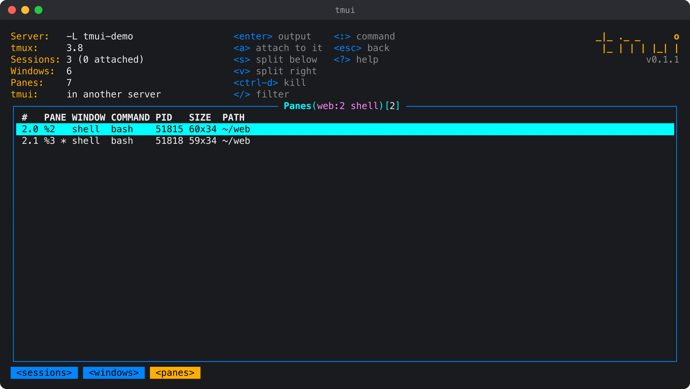
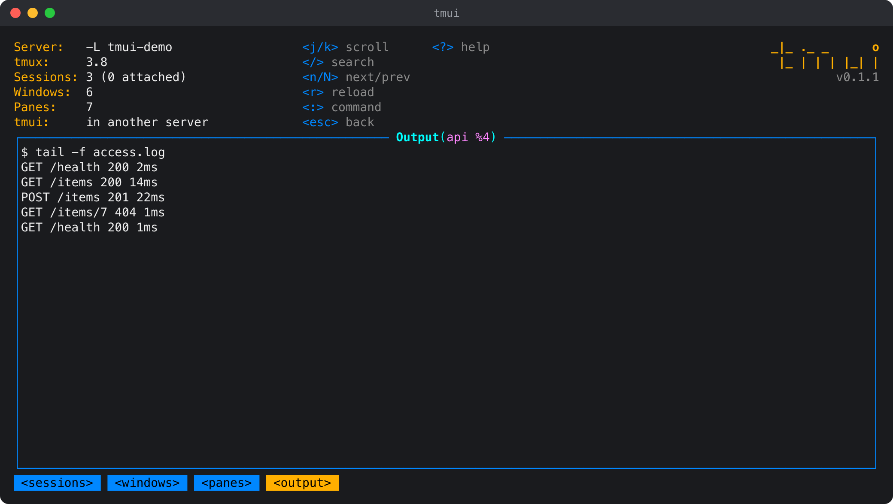

# tmui

A terminal UI for tmux. It shows a tmux server's sessions, windows and panes in one screen, lets you make, rename, split and kill them, reads any pane's output, and attaches to a session in a way that comes back to tmui when you detach.

It talks to tmux directly (`list-sessions`, `list-windows`, `list-panes`, `capture-pane`), so it works with any tmux setup and needs nothing else running.



## Install

```sh
curl -fsSL https://dl.sophonz.io/tmui/install.sh | sh
```

It puts `tmui` in `~/.local/bin` after checking its SHA-256 (`TMUI_INSTALL_DIR` puts it elsewhere, `TMUI_VERSION=v0.1.1` pins a release). With Go:

```sh
go install github.com/sophonz-labs/tmui@latest
```

Or download a binary from the [releases](https://github.com/sophonz-labs/tmui/releases) page (`tmui-<os>-<arch>.tar.gz` for macOS and Linux, amd64 and arm64; `checksums.txt` has their SHA-256 sums).

## Usage

```sh
tmui                  # the server you are in, or the default server
tmui -L work          # the server on socket name "work", as tmux -L
tmui -S /tmp/my.sock  # the server at a socket path, as tmux -S
tmui --version
```

The screen starts on the sessions list. `enter` goes down a level (sessions, windows, panes, a pane's output), `esc` comes back up. `?` lists every key.

| Windows | Panes | A pane's output |
|---|---|---|
|  |  |  |

## Keys

| Key | Where | Does |
|---|---|---|
| `j` `k` `↑` `↓`, `g` `G`, `ctrl-b` `ctrl-f` | everywhere | move, top and bottom, a page |
| `enter` `l` `→` | lists | into the row: windows, panes, output |
| `esc` `h` `←` | everywhere | back (or clear the filter); `q` also quits at the top |
| `/` | lists | filter the rows |
| `/`, `n` `N` | output | search, next and previous match |
| `a` | sessions, windows, panes | attach to it (see below) |
| `n` | sessions, windows | new session, new window |
| `R` | sessions, windows | rename |
| `s` `v` | panes | split below, split right |
| `ctrl-d` | sessions, windows, panes | kill (asks first) |
| `p` | sessions | the session's panes |
| `ctrl-r` | everywhere | refresh now (it also refreshes every 2 seconds) |
| `:` | everywhere | command: `:sessions`, `:windows [session]`, `:panes [session]`, `:tmux <args>`, `:q` |
| `?` | everywhere | help |

`:tmux <args>` runs a tmux command on the same server, for example `:tmux new-window -d -n logs` or `:tmux show -g`. What it prints opens in the pager.

## Attach and come back

Before attaching, tmui says how to get back, with your real prefix key: `attaching to web — C-b d comes back to tmui`.

- Outside tmux, tmui runs `tmux attach` in its own terminal. Detach (`prefix d`) and tmui is back where you left it.
- Inside tmux 3.2 or later, tmui opens the session in a full-size `display-popup`. Every key, the prefix included, goes to the session in the popup, so `prefix d` detaches it, the popup closes, and tmui is still there. This also works when tmui shows a different server (`-L`/`-S`) from the one it runs in.
- Attaching to the session tmui itself runs in switches to that window instead; `prefix l` returns.
- Inside tmux older than 3.2 there are no popups. On the same server tmui uses `switch-client`, and `prefix L` (last session) or `prefix s` returns. For a different server it attaches nested in tmui's pane, and `prefix prefix d` returns.

Attaching to a window or a pane selects that window or pane first.

## Requirements

- tmux 3.0 or later on `PATH`. Attaching in a popup needs 3.2; a borderless popup needs 3.3.
- macOS or Linux.

## License

MIT
